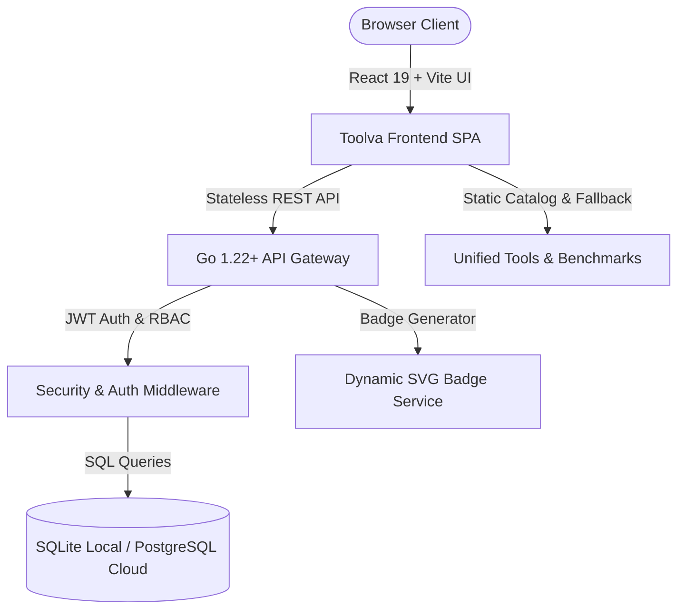

<div align="center">

# 🚀 Toolva 2.0 — Open-Source & Local AI Intelligence Platform

[](LICENSE)
[](package.json)
[](https://react.dev)
[](https://typescriptlang.org)
[](https://vitejs.dev)
[](backend)
[](docs/PORTABLE_ARCHITECTURE.md)

**The definitive community index for open-source AI, local LLM runtimes, and self-hosted intelligence.**  
*Featuring Bayesian trust scoring, verifiable hardware benchmarks, AI stack planning, dynamic README badges, and zero legacy competitor branding.*

[🌐 Live Directory](http://localhost:4185) · [💻 Hardware Benchmarks](http://localhost:4185/benchmarks) · [🧩 AI Stack Planner](http://localhost:4185/planner) · [💰 Cost Estimator](http://localhost:4185/estimator) · [📬 Support](mailto:support.toolva@gmail.com)

</div>

---

## 🌟 What Makes Toolva 2.0 Different?

Unlike commercial directories that prioritize sponsored ads and unverified marketing copy, **Toolva** is engineered specifically for AI engineers, local model runners, and open-source contributors:

1. **📐 Bayesian Trust Scoring ($WR = \frac{v}{v+m}R + \frac{m}{v+m}C$)**
   - Eliminates small-sample 5-star manipulation by dampening ratings with a global prior ($m=10$, $C=4.20$).
   - Explicit confidence levels (`low`, `moderate`, `high`) shown transparently with full formula breakdowns.
   - Separate editorial verification and community vouches: paid tiers never purchase higher Bayesian ranks.

2. **⚡ Verifiable Hardware Benchmarks**
   - Real, reproducible prompt & generation speeds (tokens/sec), peak VRAM footprints, and quantization levels (`Q4_K_M`, `FP16`, `Q8_0`).
   - Hardware comparison matrices across **NVIDIA RTX 4090**, **Apple M3/M2 Max**, **RTX 3060**, and **Intel CPU (AVX2)**.
   - Sourced provenance links directly to GitHub benchmarks and raw test configurations.

3. **🧩 Multi-Stage AI Stack Planner**
   - Translate your technical intent (e.g. *Local Code Assistant*, *Offline RAG*, *Voice Agent*) into a production-ready stack blueprint.
   - Clear local vs. cloud tradeoffs: privacy, operational cost, offline capability, and compute bottlenecks.

4. **🏷️ Dynamic SVG README Badges**
   - Embed real-time rating and verified status badges directly in your GitHub repositories.
   - Endpoints:
     - `/api/badges/:id/rating.svg`
     - `/api/badges/:id/verified.svg`
     - `/api/badges/:id/hardware.svg`
     - `/api/badges/:id/momentum.svg`

5. **🛡️ Dual Submission Workflows & 7 Transparent Tiers**
   - **Route A: Free Community GitHub PR**: Generate copy-paste JSON directly for a zero-cost open-source PR submission.
   - **Route B: Web Submission Queue**: Fast-track review queue with 7 distinct tiers and strict anti-pay-for-rank guardrails.

---

## 🏛️ System Architecture



### Architecture Guarantees
- **Stateless Backend**: Session state stored strictly in JWTs; container instances can scale horizontally.
- **Database Independence**: Abstracted SQL layer runs locally via SQLite (`toolva.db`) and switches seamlessly to PostgreSQL in production via `DATABASE_URL`.
- **SSRF Hardening**: Internal private IP ranges (`10.0.0.0/8`, `172.16.0.0/12`, `192.168.0.0/16`, `127.0.0.1`, `169.254.169.254`) are blocked at both client and server boundaries.

---

## 📚 Technical Documentation Suite

Complete technical and architectural specifications are located in [`docs/`](docs/):

| Document | Purpose |
|---|---|
| [**MVP_SCOPE.md**](docs/MVP_SCOPE.md) | Boundaries, workstreams, and post-MVP non-goals. |
| [**SYSTEM_INVENTORY.md**](docs/SYSTEM_INVENTORY.md) | Full audit of frontend, backend, routes, models, auth, and env vars. |
| [**TRUST_AND_SCORING_POLICY.md**](docs/TRUST_AND_SCORING_POLICY.md) | Mathematical Bayesian formula, weighting, and editorial policies. |
| [**SUBMISSION_AND_PR_GUIDE.md**](docs/SUBMISSION_AND_PR_GUIDE.md) | 7 submission tiers, PR generator instructions, and review SLAs. |
| [**SECURITY_REVIEW.md**](docs/SECURITY_REVIEW.md) | SSRF, CSP, input sanitization, JWT, and rate-limiting audit report. |
| [**PORTABLE_ARCHITECTURE.md**](docs/PORTABLE_ARCHITECTURE.md) | Docker containerization, SQLite/Postgres compatibility, and zero vendor lock-in. |
| [**OPERATIONS_AND_BACKUP.md**](docs/OPERATIONS_AND_BACKUP.md) | Backup, restore, migration runbook, and rollback steps. |
| [**LAUNCH_READINESS_REPORT.md**](docs/LAUNCH_READINESS_REPORT.md) | L1–L20 production launch verification audit. |

---

## 🚀 Quickstart & Development

### Prerequisites
- **Node.js**: v18.0 or higher (Node 22 recommended)
- **Go**: v1.22 or higher (for backend)
- **Git**

### 1. Frontend Setup
```bash
# Clone the repository
git clone https://github.com/SUGAM-ARORA/Toolva.git
cd Toolva

# Install dependencies
npm install

# Run unit tests (built-in runner, 0 external deps required)
npm test

# Typecheck and lint
npm run type-check
npm run lint

# Start development server
npm run dev
```

### 2. Backend Setup
```bash
cd backend

# Run backend unit tests
go test -v ./...

# Start Go API server (listens on :8080)
go run cmd/main.go
```

### 3. Build for Production
```bash
npm run build
```

---

## 🧪 Testing Suite

- **Frontend Unit Tests**: Node 22 native test runner via `scripts/test-runner.mjs`. Tests Bayesian calculations, SSRF validation, freshness checkers, and AI stack planning.
  ```bash
  npm test
  ```
- **Backend Unit Tests**: Native Go test suite for auth middleware, RBAC enforcement, and Bayesian scoring.
  ```bash
  cd backend && go test -v ./...
  ```

---

## 🤝 Contributing

We welcome community contributions! Please review [`docs/SUBMISSION_AND_PR_GUIDE.md`](docs/SUBMISSION_AND_PR_GUIDE.md) and our commit conventions:
- `feat(tools):` Adding or updating AI tool definitions
- `feat(ui):` Adding new UI components or directory views
- `fix(auth):` Security fixes or permission updates
- `docs:` Documentation and README updates

---

## 📬 Contact & Support

- **Email**: [support.toolva@gmail.com](mailto:support.toolva@gmail.com)
- **Unified Support Hub**: Visit `/contact` in the application
- **Help FAQ & Knowledge Base**: Visit `/help` in the application

---

<div align="center">

Crafted with ❤️ by **Sugam Arora** & the Toolva Open Source Community.

</div>
